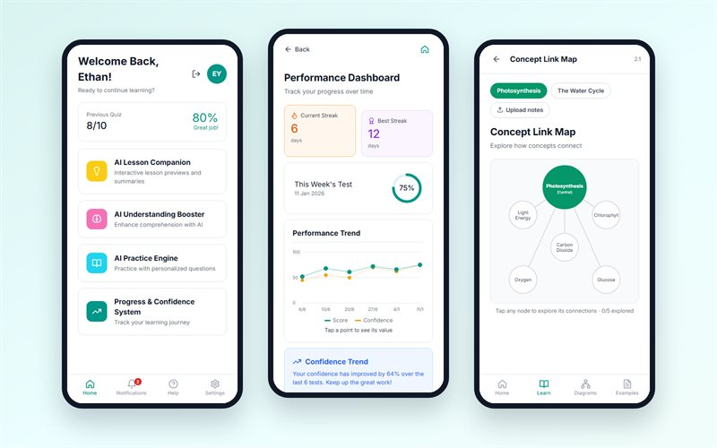

# MyLearningAI — Student Study Planner Prototype

An interactive, mobile-first prototype of **MyLearningAI**, an AI-assisted learning app for students. It turns our ST0277 Design for User Interaction (DEUI) wireframes, Figma prototype and usability-test findings into a working web app.

**Live demo:** https://ethanyap123.github.io/student-study-planner/



On a desktop, the app runs inside a phone frame; on a phone, it fills the screen. Everything runs in the browser with mock data, so no account or server is needed. Sign up or log in with any details.

## Features

**Login & Sign Up** — Welcome screen, login, password reset and sign up with 6-digit email verification.

**AI Progress & Confidence System** (the feature we usability-tested), including improvements from our usability report:

- **Weekly Test:** Upload notes (drag and drop, file picker or camera scan), supported-format guidance, file rename/delete/reorder with page detection, and quiz settings (difficulty, number of questions, question types, estimated time).
- The quiz itself has a progress and time indicator, flag and skip, instant feedback with explanations, and short-answer questions.
- Results show a topic breakdown, areas to improve and an automatic confidence-accuracy summary. The answer review includes explanations, bookmarks, filters and "redo wrong questions only".
- **Study Plan Generator:** Pick past quizzes and study hours. The plan targets your weakest topics, with to-do progress, reminders, snooze and a daily check-in time.
- **Smart Revision Sheets:** Generate a sheet from notes, then save, search and delete it.
- **Performance Dashboard:** Streaks, score and confidence trend chart, past scores, and a topic-strength heatmap with study recommendations.

**AI Practice & Feedback Engine** — Topic search, difficulty selection and randomly generated maths questions (linear equations, triangles, fractions, quadratics, percentages, area, indices). Each question has hints, step-by-step solutions, a guided tutor, misconception detection with correction practice, streaks and a session summary.

**AI Lesson Companion** — Lesson preview with a quick check, key-points highlighter, simplified slide mode (with enlarge and download) and a video generator with captions and optional voice-over.

**AI Understanding Booster** — Step-by-step explainer, interactive concept link map, generated diagrams with a zoom view, and an example library with search and filters.

**Notifications, Help & Settings** — Filterable notifications with unread badges, a searchable FAQ with a contact form, account management, privacy controls, notification preferences, and light/dark/system themes with adjustable text size.

Progress (quiz history, plans, sheets, streaks and settings) is saved in the browser's local storage. Use **Settings → Privacy & Security → Clear my data** or **Reset demo data** on desktop to start over.

## Tech

Plain HTML, CSS and vanilla JavaScript with no build step and no dependencies. It uses a hash router and is hosted on GitHub Pages.

```text
index.html              app shell and device frame
css/styles.css          design tokens (light and dark) and components
js/icons.js             inline SVG icons
js/data.js              mock data and question generators
js/app.js               state, router and shared UI helpers
js/screens-core.js      login, home, profile, notifications, help, settings
js/screens-progress.js  Progress & Confidence System
js/screens-practice.js  Practice & Feedback Engine
js/screens-learn.js     Lesson Companion and Understanding Booster
```

## Run Locally

1. Clone or download this repository.
2. Open the project folder in your terminal.
3. Start a local web server:

```bash
python -m http.server 8000
```

4. Open http://localhost:8000 in your browser.

No additional packages or dependencies are required.

## Context

Built for ST0277 Design for User Interaction at Singapore Polytechnic (DIT, Year 1).

The design follows our group's sitemap, wireframes and Figma prototype, and the recommendations from our CA3 usability test report.

The objective of this project was to explore how AI-assisted features could support students in planning their studies, understanding difficult concepts, practising questions and tracking their learning progress.

This coded prototype demonstrates how our original designs and usability findings can be translated into an interactive web application.

## What I Learned

- **Turning designs into code:** Translating our Figma wireframes into a functional web application helped me understand how UI/UX design decisions affect actual implementation. I also learned to handle missing design details, such as empty states, error messages and user feedback.

- **Improving user experience through testing:** Usability testing showed us areas where users struggled, particularly during quizzes. Based on their feedback, we introduced progress indicators, time tracking, and flag and skip options to improve navigation and usability.

- **Strengthening JavaScript skills:** Building interactive features helped me improve my understanding of JavaScript, DOM manipulation, event handling, and managing application state.

- **Managing data without a backend:** Using local storage taught me how to persist user progress, quiz results, study plans and preferences across browser sessions.

- **Building responsive interfaces:** Developing a mobile-first application taught me how to adapt layouts for different screen sizes while maintaining a consistent user experience.

- **Problem-solving and debugging:** Integrating multiple features into one application helped me develop better debugging skills and understand the importance of organizing code into reusable components.

- **Understanding the development process:** This project showed me how user research, wireframing, prototyping, usability testing and implementation work together to create a more user-friendly product.

## Challenges Faced

**1. Translating Figma designs into a working application**

Although our Figma prototype provided the overall interface design, some interactions and edge cases were not fully defined. I had to consider how buttons, forms, navigation and feedback messages should behave in a functional application.

**2. Managing multiple features and screens**

The application contains several learning modules, each with different interactions. Organizing the JavaScript files and maintaining a consistent interface across screens was challenging.

**3. Maintaining user progress**

Since the prototype does not have a backend database, I used browser local storage to save user progress and preferences. This helped me understand how application state can be maintained between sessions.

**4. Improving usability**

Feedback from our usability testing highlighted problems that were not obvious during the design stage. Incorporating these improvements into the coded prototype helped me understand the importance of designing around actual user behaviour rather than assumptions.

**5. Making the application responsive**

Ensuring the interface worked properly on both mobile devices and desktop browsers required adjustments to layouts, spacing and component sizing.

## Future Improvements

Although MyLearningAI is currently a browser-based prototype, there are several opportunities for further development:

- **Real AI integration:** Connect the application to an AI API to generate personalized quizzes, explanations, revision materials and study recommendations.

- **Backend and database:** Implement secure authentication and a database to store user accounts, learning progress and study history across devices.

- **Personalized learning:** Improve recommendations based on students' quiz performance, confidence levels and learning habits.

- **Accessibility improvements:** Enhance keyboard navigation, screen-reader compatibility and overall accessibility.

- **Further usability testing:** Conduct additional testing with students to identify usability issues and refine the learning experience.

- **Cross-device synchronization:** Allow users to access their study plans, quiz results and revision materials across multiple devices.

- **Collaborative Revision:** Shared revision sheets and peer-to-peer flashcard challenges.

## Credits

The app design, wireframes and usability research are by **DEUI Group 1**:

- **Chloe** ([@Chloelzx25](https://github.com/Chloelzx25)): Login and sign-up flow, home page, AI Lesson Companion.
- **Ying En** ([@yingearnn](https://github.com/yingearnn)): Sitemap, AI Progress & Confidence System.
- **Brian** ([@brian1518](https://github.com/brian1518)): AI Understanding Booster, usability test videos.
- **Ethan** ([@EthanYap123](https://github.com/EthanYap123)): AI Practice & Feedback Engine, reports; built this coded prototype.

---

**MyLearningAI** — A student-focused learning prototype developed as part of Singapore Polytechnic's ST0277 Design for User Interaction module.
